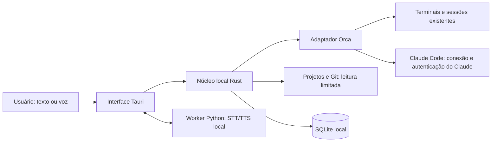

# SPEC: Jarvis local para projetos e sessões do Orca

**Status:** SPEC aprovada pelo usuário em 2026-10-17 como base do plano de implementação. O app abre na conversa central, consulta pastas/Git locais e transcreve push-to-talk com Whisper offline. A saída falada agora tem integração Pocket TTS com a amostra Jarvis e idioma português; a instalação dos pesos é uma ação explícita em Configurações e exige aprovação/token de leitura da Hugging Face no primeiro download. A qualidade sonora ainda aguarda avaliação no desktop do usuário. A leitura de sessões do Orca ainda não está implementada.
**Atualizado:** 2026-10-17

## 1. Objetivo

Criar um Jarvis local que sirva de central para os projetos e agentes de desenvolvimento do usuário. A primeira versão deve aproveitar projetos e sessões já existentes no Orca, reunindo numa conversa só o acompanhamento de vários agentes sem misturar os contextos dos projetos.

O usuário deve poder conversar por texto e voz, consultar quais projetos estão em andamento, entender a atividade recente e encaminhar respostas ao agente certo. O Jarvis também deve poder ler arquivos locais e ajudar a executar tarefas nos projetos, respeitando as permissões e o fluxo dos agentes existentes.

## 2. Decisões aprovadas

### 2.1 Começar integrado ao Orca

- O MVP começa usando o Orca como fonte dos projetos, worktrees e sessões existentes.
- O Jarvis pode ter sua própria interface; não precisa ser implementado dentro do Orca.
- A conversa central agrega atualizações, mas cada agente continua com seu próprio contexto, projeto e sessão.
- Se houver uma sessão Claude Code ativa no Orca, a preferência é encaminhar mensagens a essa sessão em vez de iniciar outra sessão concorrente para o mesmo trabalho.
- Sessões paradas podem ser retomadas quando o identificador e o mecanismo disponível permitirem.
- A integração com o Orca deve ficar atrás de uma fronteira substituível para permitir, no futuro, um gerenciador próprio de projetos/sessões ou um possível clone do Orca. Esse clone não faz parte do MVP.

### 2.2 Escopo aprovado para o MVP

- Listar projetos configurados do Orca e mostrar atividade recente: branch, alterações no Git, sessão associada e última atividade disponível.
- Acompanhar várias sessões Claude Code numa caixa de entrada central, sempre identificando projeto e agente.
- Exibir a atividade recente das sessões e encaminhar mensagens para a sessão escolhida.
- Retomar sessões paradas quando isso for tecnicamente possível e seguro.
- Consultar dados locais dos projetos, começando por Git, arquivos de orientação como `README` e alterações recentes. Indexação completa do disco fica para uma etapa posterior.
- Oferecer texto e voz na mesma conversa, com push-to-talk e transcrição visível. A resposta falada fica disponível quando uma voz local correspondente à amostra for validada em qualidade e latência na máquina alvo.
- Abrir o app diretamente na conversa central; permitir perguntas locais sobre pastas e Git mesmo enquanto o Orca ou os modelos de voz estiverem indisponíveis.
- Guardar localmente projetos configurados, preferências e o histórico da conversa com o Jarvis.
- No MVP, acompanhar, responder e retomar sessões existentes quando possível. Iniciar sessões próprias pelo Jarvis fica para uma evolução.

### 2.3 Localidade e conexão

- A interface, o catálogo de projetos, o histórico do Jarvis, a leitura local dos arquivos e os recursos de voz devem poder funcionar localmente.
- Claude Code continua dependendo da conexão e autenticação do Claude. “Offline” se aplica às funções locais do Jarvis; não torna o Claude Code offline.
- Um modelo local pode ser avaliado para consultas sobre arquivos e funcionamento sem rede, mas o modelo e sua capacidade ainda não foram escolhidos.

### 2.4 Fora do MVP

- Clonar o Orca ou fazer engenharia reversa de interfaces internas.
- Varredura/indexação completa do disco ou busca semântica vetorial.
- Wake word/escuta contínua e execução de shell sem confirmação.
- Encaminhar automaticamente mensagens de um agente para outro.
- Notícias, busca web e ferramentas gerais do clone J.A.R.V.I.S. podem ser módulos opcionais posteriores; não são necessárias para a central de projetos e sessões.

## 3. Cenários principais

1. O usuário pergunta “quais projetos estão em andamento?” e vê projetos classificados usando atividade do Orca, sessões e metadados recentes do Git.
2. Duas sessões em projetos diferentes produzem atualizações. O Jarvis mostra cada mensagem com o projeto/agente de origem e indica quando é necessária uma resposta.
3. O usuário escolhe ou responde por texto/voz; o Jarvis encaminha a mensagem à sessão correta e mostra o resultado.
4. O usuário abre um projeto e pede um resumo local de seu estado recente, usando inicialmente arquivos de orientação e alterações Git.
5. O usuário retoma uma sessão parada sem perder o contexto salvo pelo Claude Code.

## 4. Alternativas consideradas

| Opção | Descrição | Avaliação atual |
|---|---|---|
| A. Jarvis como painel do Orca | Integrar projetos, worktrees, terminais e sessões existentes; centralizar atualizações e respostas. | **Escolhida para o MVP.** Reaproveita o fluxo atual do usuário. |
| B. Jarvis como gerente de sessões | Jarvis cria e gerencia sessões via CLI ou Agent SDK, mantendo controle mais direto do fluxo. | Possível evolução; não é requisito para o primeiro corte. |
| C. Gerenciador próprio/clone do Orca | Construir o catálogo, a gestão de projetos e o runtime de agentes próprios. | Possibilidade futura. Escopo e viabilidade ainda não avaliados; não iniciar agora. |

## 5. Arquitetura recomendada e aprovada, sujeita a validação técnica

O desenho aprovado mantém responsabilidades separadas para que a integração Orca possa ser substituída no futuro:

- **Interface desktop:** Tauri 2 com TypeScript/React para projetos, caixa de entrada e conversa.
- **Núcleo local Rust:** coordena adaptadores, escopo de arquivos, operações Git, processos autorizados e armazenamento SQLite; a interface chama operações específicas, não um shell livre.
- **Adaptador Orca:** encapsula descoberta e controle usando a interface suportada pelo Orca.
- **Adaptador Claude:** no MVP chama o CLI/mecanismos existentes; Agent SDK é uma opção futura para sessões iniciadas pelo Jarvis.
- **Camada de voz:** worker Python opcional com STT/TTS local, atrás de uma interface substituível.
- **Catálogo e armazenamento:** metadados de projeto, mapeamentos, preferências, eventos e histórico próprio do Jarvis ficam localmente.

Essa é a arquitetura-alvo. O primeiro spike deve validar o adaptador Orca e a voz antes de investir no empacotamento completo. Se a integração funcionar melhor com uma stack menor, os adaptadores devem permitir revisar a escolha sem reescrever produto e fluxos.

### Integração de sessões: hipótese a validar

- Para sessões ativas, usar a interface de terminal/API do Orca, se ela permitir observar saída e enviar entrada de forma confiável.
- Para sessões paradas, avaliar `claude --resume <session-id>` e as APIs do Agent SDK para retomar e acompanhar sessões persistidas.
- Não iniciar um segundo Claude para um projeto quando uma sessão ativa equivalente já estiver sendo controlada.
- O comportamento para detectar que o agente terminou, está esperando aprovação ou precisa de resposta precisa ser validado com sessões reais do Orca.
- Acesso direto ao processo/terminal e dependência de detalhes internos do Orca ainda não foram decididos.

## 6. Voz e protótipos existentes

Possíveis referências locais, sem decisão de reutilização direta:

- `/git/jarvis/jarvis-local`: protótipo Python com Ollama, Parakeet STT, Pocket TTS e interface simples. Pode servir para avaliar os fluxos e componentes de voz; o README descreve um projeto orientado a Windows, então portabilidade precisa ser verificada.
- `/git/jarvis/J.A.R.V.I.S`: protótipo de assistente com Python, Ollama e interface React/Electron; possui exemplos de ferramentas locais. Usar como referência, não assumir que será a base do produto.
- `/git/FERRAMENTAS-LOCAL/OmniVoice`: clone de clonagem de voz a testar para síntese local.
- `/git/jarvis/JarvisExample.mp3`: amostra de referência da voz desejada.

O primeiro fluxo de voz pode usar uma voz local disponível e push-to-talk. Fidelidade à voz de referência, latência, compatibilidade com a máquina e integração com OmniVoice ficam como investigação dedicada.

## 7. Pesquisa de projetos e documentação

Estes projetos servem como referências de capacidades; nenhum foi escolhido como dependência ou base do MVP.

- [Claude Code CLI](https://code.claude.com/docs/en/cli-reference): documenta opções de continuação e retomada de sessões.
- [Claude Agent SDK — sessões](https://code.claude.com/docs/en/agent-sdk/sessions): referência para persistência, identificação e retomada de sessões geridas pelo SDK.
- [Claude Agent SDK — entrada em streaming](https://code.claude.com/docs/en/agent-sdk/streaming-vs-single-mode) e [saída em streaming](https://code.claude.com/docs/en/agent-sdk/streaming-output): referências para processos persistentes e eventos de interação.
- [Alethe](https://github.com/Kc1t/alethe-agents): referência de aplicativo desktop multiagente e sessões; avaliar maturidade e licença antes de qualquer reutilização.
- [Goose](https://github.com/aaif-goose/goose): referência de runtime Rust com CLI, desktop e integrações de provedores/MCP.
- [Vibe Kanban](https://github.com/BloopAI/vibe-kanban): referência de organização de trabalho com agentes; na pesquisa consultada, o projeto se apresentava como em encerramento, portanto não é recomendado como base sem nova verificação.
- [Open Interpreter](https://github.com/openinterpreter/open-interpreter): referência para execução de ferramentas local, mas não é por si só um cockpit de projetos e sessões Orca.
- [codewithbro95/J.A.R.V.I.S](https://github.com/codewithbro95/J.A.R.V.I.S): referência para ferramentas de assistente local; o clone do usuário já está em `/git/jarvis/J.A.R.V.I.S`.
- [Visão geral do Claude Agent SDK](https://code.claude.com/docs/en/agent-sdk/overview): o SDK documentado é para Python e TypeScript; para outras linguagens, a documentação recomenda acionar o CLI como subprocesso.
- [Tauri: sidecars](https://v2.tauri.app/develop/sidecar/) e [plugin SQL](https://v2.tauri.app/plugin/sql/): referências oficiais para empacotar processos auxiliares com permissões explícitas e usar SQLite numa aplicação Tauri.

## 8. Riscos e validações técnicas

1. **Sessões ativas do Orca:** verificar se é possível acompanhar saída e responder sem interferir no terminal ou duplicar a sessão.
2. **Sessões retomáveis:** confirmar como mapear projeto, diretório de trabalho e ID da sessão Claude.
3. **Estado de espera do agente:** diferenciar saída normal, pergunta ao usuário, aprovação de ferramenta e conclusão.
4. **Acesso local:** validar que leitura e busca ficam restritas às raízes configuradas.
5. **Execução de comandos:** validar que comandos diretos do Jarvis exibem comando e diretório e exigem confirmação, e que pedidos de aprovação do Claude chegam à caixa de entrada.
6. **Operação offline:** testar STT, TTS e eventual modelo local na máquina-alvo, sem presumir capacidade de hardware.
7. **Integração Orca:** o runtime do Orca não estava disponível durante o levantamento; a compatibilidade da integração permanece não verificada.

## 9. Questões em aberto

- Qual é o sistema operacional e o hardware alvo para voz/modelo local?
- Como configurar as raízes de projeto: importar do Orca, selecionar pastas manualmente ou ambos?
- Qual política de retenção o usuário prefere para saídas de terminal, transcrições e histórico do Jarvis?
- Qual modelo local (se houver) atende a síntese de respostas sobre arquivos e o hardware disponível?
- A clonagem de voz alcança qualidade/latência suficientes na máquina alvo para entrar na primeira versão distribuída?
- Como os eventos do Orca permitem distinguir conclusão, espera por resposta e aprovação de ferramenta?

## 10. Próximos passos de planejamento

1. Executar o spike documentado para confirmar descoberta, leitura, envio e retomada de sessões Orca.
2. Testar STT/TTS e clonagem de voz na máquina alvo.
3. Fechar detalhes de configuração de raízes, retenção e comportamento de notificações.
4. Implementar a fundação desktop e, depois do gate Orca, a caixa de entrada e o acesso local aos projetos.
5. Rever critérios de aceitação e decidir se o MVP está pronto para uso.

## 11. Design aprovado: caixa de entrada central

**Estado:** aprovada pelo usuário em 2026-10-17, com a ressalva de que estados e encaminhamento dependem da integração técnica.

- Cada item da caixa de entrada identifica claramente projeto, worktree e sessão/agente.
- A conversa central reúne eventos, mas cada sessão mantém uma thread independente; o Jarvis não mistura históricos.
- Estados iniciais sugeridos: `trabalhando`, `precisa de resposta`, `concluído` e `estado incerto`.
- Para responder, o usuário seleciona a thread. Se responder por voz sem indicar o destino e houver mais de um agente aguardando, o Jarvis pergunta a qual projeto encaminhar.
- No MVP, o Jarvis não encaminha automaticamente a resposta de um agente para outro agente; o usuário decide o que deve ser repassado.
- Até a integração confirmar estados estruturados, o Jarvis deve mostrar a saída observada e indicar incerteza em vez de afirmar que um agente está esperando.
- Resumos automáticos podem ser adicionados depois; inicialmente, mostrar a mensagem/saída relevante e permitir que o Jarvis a leia em voz alta reduz o risco de mudar o sentido da resposta.

## 12. Design aprovado: integração das sessões

**Estado:** recomendação aprovada pelo usuário em 2026-10-17; a viabilidade depende do spike de integração.

### Opções

| Opção | Como funciona | Vantagem | Limite |
|---|---|---|---|
| A. Adaptador Orca, com retomada pelo Claude quando necessário | Usar as operações suportadas pelo Orca para listar sessões/terminais e ler, aguardar ou enviar entrada. Para sessões paradas, testar a retomada do Claude pelo identificador. | Mantém o fluxo que o usuário já tem e evita duplicar sessões ativas. | Depende de o Orca expor saída/entrada com estabilidade e de conseguirmos mapear IDs, projeto e terminal. |
| B. Agent SDK para sessões geridas pelo Jarvis | O Jarvis cria e controla sessões por uma API estruturada do Claude Agent SDK. | Eventos e controle têm uma interface mais própria para um inbox central. | Pode não se encaixar diretamente em processos Claude já abertos pelo Orca; avaliar como evolução para sessões iniciadas pelo Jarvis. |
| C. Automação direta de terminal/processo | O Jarvis controla processos/terminais sem passar por uma API suportada do Orca. | Poderia funcionar como ponte se não houver interface suficiente. | Mais frágil e sujeito a mudanças de terminal e implementação; não recomendado como fundação sem necessidade comprovada. |

### Recomendação atual

Usar a opção A no MVP, por trás de um adaptador Orca. Fazer primeiro um teste somente de leitura; depois validar envio de uma mensagem numa sessão escolhida. Usar o Agent SDK como opção para sessões que o próprio Jarvis venha a iniciar no futuro. Manter a opção C apenas como experimento de viabilidade, não como dependência central.

Não acessar banco interno, formato privado ou comportamento não documentado do Orca como parte do primeiro caminho. A possibilidade futura de um clone do Orca continua aberta, mas deve ser uma decisão própria depois que o MVP mostrar quais capacidades realmente faltam.

### Validação necessária

O Orca CLI disponível neste ambiente oferece comandos para consultar/ler, aguardar e enviar entrada a terminais, mas o runtime do Orca não estava conectado durante o levantamento. Portanto, ainda não foi confirmado que uma sessão ativa pode ser observada e respondida pela máquina do usuário. Esse é o primeiro spike técnico, antes de fechar a arquitetura e a stack.

## 13. Design aprovado: acesso aos projetos e execução de comandos

**Estado:** recomendação aprovada pelo usuário em 2026-10-17.

### Leitura dos projetos

- Começar pelas pastas de projetos que o usuário configurar/importar do Orca; evitar varrer o disco todo.
- No MVP, mostrar metadados do Orca e do Git e ler arquivos de orientação/alterações recentes.
- Leitura adicional de arquivos deve ocorrer dentro das raízes configuradas e ser indicada na interface. Indexação completa do conteúdo exige uma decisão posterior.

### Execução de tarefas

- Para tarefas delegadas a uma sessão Claude Code, o Jarvis encaminha a mensagem e apresenta pedidos de aprovação que o agente emitir; ele não deve contornar as permissões do Claude Code.
- Se o próprio Jarvis executar um comando de shell, a proposta para o MVP é mostrar o comando exato e a pasta de trabalho e pedir confirmação antes da execução.
- Comandos ditados por voz devem ser transcritos e apresentados para confirmação antes de rodar, para que erros de reconhecimento não executem uma ação inesperada.
- Permissões recorrentes ou listas de comandos confiáveis podem ser avaliadas depois, por projeto e com escopo explícito.
- O acesso a arquivos e comandos deve ficar atrás de interfaces próprias, separadas do adaptador Orca, para que uma implementação futura possa trocar o backend sem refazer a política de permissões.

### Alternativas de permissão consideradas

| Opção | Comportamento | Avaliação atual |
|---|---|---|
| A. Leitura local limitada + confirmação por comando | Jarvis lê apenas projetos configurados; para executar diretamente, mostra comando e diretório e pede confirmação. | Recomendada para o MVP: permite trabalho útil mantendo o usuário no controle. |
| B. Comandos confiáveis configuráveis | O usuário autoriza categorias/listas por projeto; ações fora delas pedem confirmação. | Evolução possível depois de observar os comandos recorrentes. |
| C. Acesso amplo e execução sem confirmação | Jarvis pode acessar o computador e executar comandos arbitrários sem revisão por ação. | Não recomendada para o MVP; o impacto e as proteções dependem de decisões ainda abertas sobre sistema operacional e isolamento. |

## 14. Design aprovado: atividade e consulta local de projetos

**Estado:** recomendação aprovada pelo usuário em 2026-10-17.

### Como identificar atividade

- Exibir sinais observáveis em vez de tratar “em andamento” como uma certeza inferida: sessão ativa/aguardando no Orca, atividade recente de Git e estado da worktree.
- Separar “agente trabalhando agora”, “precisa de resposta”, “atividade recente” e “sem atividade recente”. Quando o adaptador não tiver evidência confiável, marcar o estado como incerto.
- Mostrar por que o projeto aparece como ativo (por exemplo, terminal ativo ou alterações locais) e permitir que o usuário fixe/arquive projetos manualmente.
- Evitar usar apenas `mtime` de arquivos para dizer que um projeto está ativo; builds, ferramentas e sincronização podem alterar datas sem trabalho humano recente.

### Como consultar arquivos no MVP

- Usar como fontes iniciais os metadados do Orca/Git, arquivos de orientação (`AGENTS.md`, `README` e documentação relevante) e diferenças/commits recentes.
- Fazer buscas e leituras sob demanda dentro das raízes permitidas, sem indexar todo o disco de início.
- Para responder perguntas sobre conteúdo, recuperar trechos locais e, se houver um modelo local compatível, pedir que ele sintetize apenas esse contexto. A resposta deve apontar os arquivos usados e não afirmar que um projeto está ativo só com base no texto do modelo.
- Se não houver modelo local disponível, ainda oferecer consultas determinísticas como status, branch, commits e arquivos modificados; a síntese em linguagem natural pode ser limitada.
- Não enviar arquivos para Claude automaticamente só porque foram lidos localmente. Se uma mensagem ao agente precisar de contexto adicional, indicar o que será incluído e manter o envio vinculado à confirmação/ação explícita do usuário.

### Recomendação atual

Começar com atividade baseada em evidências do Orca e Git e leitura local sob demanda, sem indexação vetorial nem varredura completa. Essa abordagem atende à pergunta “quais projetos estão em andamento?” sem exigir um LLM local no primeiro dia, e deixa sumarização local como uma capacidade opcional. Um banco local pode guardar metadados e histórico próprio; a tecnologia e a política de retenção seguem abertas.

## 15. Design aprovado: interação por voz

**Estado:** recomendação aprovada pelo usuário em 2026-10-17; a clonagem depende de validação na máquina alvo.

### Interação proposta

- Manter texto e voz disponíveis na mesma conversa; voz não deve ser um modo separado que esconda o histórico textual.
- Começar com push-to-talk acionado pelo usuário. Wake word e escuta contínua ficam para depois, se ainda forem desejadas.
- Mostrar a transcrição antes de encaminhar uma resposta a um agente. Se houver mais de uma sessão aguardando, pedir para escolher o destino.
- Para comandos ditados, mostrar transcrição, destino e comando exato antes de pedir confirmação para executar.
- Não narrar várias sessões ao mesmo tempo. Avisar que há respostas pendentes e ler a mensagem selecionada pelo usuário.

### Voz sintetizada e clonagem

- Projetar a voz como adaptador substituível, para que o restante do Jarvis não dependa de uma única biblioteca ou modelo.
- Fazer uma prova local com OmniVoice usando o MP3 de referência e comparar qualidade, latência, uso de recursos e facilidade de uso no sistema alvo. Como candidato interativo, usar Pocket TTS, que declara suporte a clonagem de voz e português; consultar a [API oficial](https://kyutai-labs.github.io/pocket-tts/API%20Reference/python-api/) e o [repositório oficial](https://github.com/kyutai-labs/pocket-tts).
- A saída falada deve usar uma voz local avaliada contra o MP3 de referência. Não usar um TTS genérico como fallback automático: o usuário rejeitou a voz do sistema por ser robotizada e quebrada.
- A voz clonada é o objetivo de experiência, mas só deve ser considerada pronta para o MVP depois que passar por revisão perceptual do usuário e tiver latência adequada à conversa.
- Para STT, foi escolhido inicialmente Whisper local porque o checkpoint está em cache e a transcrição offline foi confirmada nesta máquina. Parakeet pode ser avaliado depois se a latência ou precisão pedirem uma alternativa.
- Uma avaliação inicial do OmniVoice usou transcrição automática e não mediu qualidade perceptual. A nova avaliação com o texto correto da amostra levou 102,9 segundos para gerar 4,1 segundos de fala em CPU; não habilitar como resposta interativa enquanto a latência for essa.
- O Jarvis inclui uma ação explícita de configuração do Pocket TTS em Configurações. Ela baixa pacote e pesos uma vez, gera o estado da voz a partir de `JarvisExample.mp3` e mantém a síntese em modo offline. Como os pesos de clonagem são gated na Hugging Face, a pessoa precisa aceitar as condições e fornecer um token de leitura durante a preparação; o token fica apenas em memória e não é persistido. Falhas de instalação/modelo mostram o diagnóstico do subprocesso. O usuário testa o áudio antes de ligar a leitura automática; cada resposta também pode ser ouvida manualmente.

### Recomendação atual

Incluir voz no MVP com push-to-talk, transcrição visível e resposta falada. Fazer o caminho da clonagem em paralelo como validação técnica, sem bloquear o desenvolvimento da interface e da integração com o Orca. Não escolher modelos ou requisitos de hardware antes de medir na máquina alvo.

## 16. Arquitetura aprovada, sujeita aos gates técnicos: stack e estrutura do app

**Estado:** recomendação aprovada pelo usuário em 2026-10-17. O investimento no empacotamento completo depende do spike com Orca e da prova de voz.

### Opções

| Opção | Estrutura | Avaliação |
|---|---|---|
| A. Tauri 2 + Rust + TypeScript/React, com worker Python de voz | App desktop Tauri; Rust concentra adaptadores Orca/Git, permissões, processos e acesso ao SQLite; UI em TypeScript/React; worker Python opcional para os modelos locais de voz. | Melhor equilíbrio para o desktop local desejado e para a preferência por Rust. Aumenta a complexidade de empacotamento da voz e usa mais de uma linguagem. |
| B. Serviço Python local + UI web | Backend Python controla processos, catálogo e voz; frontend web acessado localmente. | Mais rápido para reaproveitar os protótipos Python e bibliotecas de voz; experiência de desktop e distribuição precisam ser resolvidas depois. |
| C. Electron + TypeScript | UI desktop e orquestração em JavaScript/TypeScript, possivelmente reaproveitando ideias do clone J.A.R.V.I.S. | Pode reaproveitar ideias do clone; o README indica reestruturação, e custo de empacotamento/consumo precisaria ser medido. |

### Recomendação atual

Usar a opção A como arquitetura-alvo, mas validar primeiro os dois pontos de maior risco antes de investir na shell completa:

1. Fazer um spike pequeno para listar, ler e enviar mensagem a um terminal real do Orca.
2. Executar STT/TTS local e a prova de voz clonada na máquina alvo.

Se o spike confirmar a integração, manter um núcleo Rust com interfaces próprias para Orca, Git, leitura de arquivos, execução autorizada e armazenamento; a UI Tauri deve chamar operações específicas desse núcleo, nunca um shell arbitrário diretamente. O frontend pode usar TypeScript/React. A camada de voz pode ser um worker Python separado, baseado no que for validado de `jarvis-local` e OmniVoice. O histórico e as configurações podem começar em SQLite.

No MVP, chamar Orca e Claude pelos mecanismos CLI já usados pelo usuário. Não integrar o Agent SDK até existir necessidade de criar sessões próprias. Se essa necessidade aparecer, a documentação oficial oferece SDK em Python/TypeScript ou execução do CLI como subprocesso a partir de outra linguagem.

### Condições para rever a recomendação

- Se empacotar STT/TTS como worker Python tornar a instalação pesada ou frágil, testar serviço Python local separado ou outra forma de integração antes de abandonar a separação dos adaptadores.
- Se o spike mostrar que a integração Orca funciona melhor em Python ou TypeScript, preferir reduzir componentes a preservar Rust por preferência de linguagem.
- Se a distribuição desktop for prematura, validar os fluxos com um serviço local e UI web antes de fechar a shell final.

## 17. Critérios de aceitação do MVP

O MVP estará pronto para avaliação do usuário quando:

1. O usuário conseguir configurar/importar projetos do Orca e ver branch, estado Git e evidências de atividade disponíveis.
2. Duas ou mais sessões forem exibidas com projeto/worktree e identidade próprios, sem misturar históricos.
3. O usuário conseguir ler a saída de uma sessão e encaminhar uma mensagem de texto para o terminal/sessão escolhida; estados não detectáveis devem aparecer como incertos.
4. O Jarvis conseguir retomar uma sessão parada por ID quando suportado; se não for possível, informar isso sem iniciar outra sessão silenciosamente.
5. A entrada por voz local funcionar por push-to-talk com transcrição visível e possibilidade de corrigir/confirmar antes de enviar.
6. O TTS local ler uma mensagem selecionada; a clonagem de voz passar por avaliação de qualidade e latência, podendo permanecer como requisito pós-MVP se não for estável.
7. Consultas básicas de projeto usarem fontes locais configuradas e mostrarem de quais arquivos/dados veio a resposta; a função não depender de internet.
8. Um comando executado diretamente pelo Jarvis mostrar o comando e o diretório de trabalho e exigir confirmação; mensagens ao Claude preservarem o fluxo de permissões do Claude Code.
9. Configurações e histórico do Jarvis persistirem localmente, sem envio automático de arquivos de projeto para um serviço externo.

## 18. Ideias estacionadas para depois do MVP

- Criar sessões próprias do Jarvis usando Agent SDK, mantendo o adaptador de agentes.
- Um gerenciador de projetos/sessões próprio ou eventual clone do Orca, somente se a integração suportada não cobrir necessidades reais.
- Busca web/notícias e ferramentas gerais inspiradas no clone J.A.R.V.I.S., como módulos opcionais que podem usar rede e devem ser claramente separados das funções offline.
- Wake word, comandos confiáveis por projeto e indexação local mais ampla, depois de validar o fluxo básico e as preferências de privacidade.

## 19. Decisão de execução após o spike do Orca

**Data:** 2026-10-17

- O CLI foi executado nesta sessão de agente em um contexto isolado e retornou `runtime_unavailable`, embora o usuário confirme que a interface do Orca está aberta. Isso não comprova falha no desktop do usuário nem prova que as sessões estejam acessíveis ao Jarvis.
- O usuário autorizou seguir com a fundação desktop e armazenamento local enquanto esse bridge permanece bloqueado.
- O usuário autorizou também selecionar pastas de projeto manualmente, sem depender do Orca. O acesso começa apenas nessas raízes escolhidas; o Jarvis não varre o disco.
- O estado Git é consultado somente quando a raiz Git coincide com a pasta configurada. Se o repositório ficar acima dela, o Jarvis não lê o estado desse repositório.
- A leitura pontual aceita caminhos relativos dentro da raiz e rejeita travessia ou symlink para fora. A busca local respeita arquivos ignorados e limita trechos; os resultados ficam no dispositivo e não são enviados a agentes.
- Catálogo, leitura de terminais, envio e retomada de sessões do Orca continuam condicionados ao spike; não será criada uma alternativa baseada em interfaces internas ou comportamento presumido do Orca.
- O cadastro de raízes locais, a atividade Git e a integração Orca são fronteiras separadas. Remover uma pasta do catálogo local não apaga arquivos nem altera sessões do Orca.

## 20. Feedback após a primeira execução do desktop

**Data:** 2026-10-17

- O usuário iniciou o app pela própria máquina com `npm run tauri dev`; a compilação e a abertura do desktop foram confirmadas.
- A primeira tela não oferecia uma conversa útil, voz direta ou sessões conectadas. O usuário pediu uma interface mais intuitiva e autônoma.
- A direção aprovada dentro do escopo existente é abrir o Jarvis na conversa central, responder localmente a perguntas factuais sobre as pastas configuradas e exibir o estado real do CLI do Orca.
- O status “CLI acessível” não pode ser apresentado como sessão conectada. Nenhuma mensagem deve ser enviada a um agente até que a sessão e o destino tenham sido verificados.
- Pesos locais de OmniVoice e Whisper foram encontrados no cache. Whisper conseguiu transcrever offline. O app usava Speech Dispatcher local, mas o usuário relatou que a voz era robotizada e quebrada; essa leitura foi removida.

## 21. Feedback sobre funcionamento, Orca e voz

**Data:** 2026-10-17

- O usuário relatou que o Jarvis não mostra o que está rodando no Orca e que a voz falada está muito robotizada, diferente do MP3 de referência.
- A investigação confirmou que o cartão de conexão só executa `repo list --json`; não lista worktrees/terminais, não observa sessões e não encaminha mensagens. A conversa local responde apenas com regras para pastas cadastradas e Git.
- O CLI oficial `orca` foi selecionado para o ambiente Orca-gerenciado conforme o guia local. Os comandos de leitura `repo list`, `worktree ps` e `worktree current` ainda retornaram `runtime_unavailable` neste contexto de execução do agente; o acesso a sessões continua sem validação.
- A transcrição local do MP3 foi corrigida para: “Olá, senhor! Hoje estão fazendo 20 graus. O clima está propenso. Dos seus últimos projetos do ORCA, o que mais precisa ser revisado é o modelo de gestão de saúde.”
- Com essa transcrição, OmniVoice em `float32`, 4 threads e 16 passos gerou 4,1 segundos de áudio em 102,9 segundos de CPU. Isso não é rápido o suficiente para resposta falada interativa. O arquivo de avaliação fica em `/tmp/jarvis-omnivoice-correct-ref.wav`; a qualidade ainda precisa ser ouvida pelo usuário.
- O protótipo Python `jarvis-local` já contém um caminho de clonagem com Pocket TTS em streaming. A integração do desktop usa um worker persistente e exige uma preparação única acionada pelo usuário; o worker fixa `HF_HUB_OFFLINE=1` e não baixa nada durante o uso normal.
- O ambiente usado pelo agente não tem Pocket TTS instalado nem os pesos em cache, então o fluxo de setup, a reprodução e a semelhança com a amostra ainda precisam ser confirmados no desktop do usuário.
- A leitura automática começa desligada para o usuário ouvir o teste primeiro. A fala genérica do sistema continua removida; leitura/envio às sessões do Orca continuam indisponíveis.
